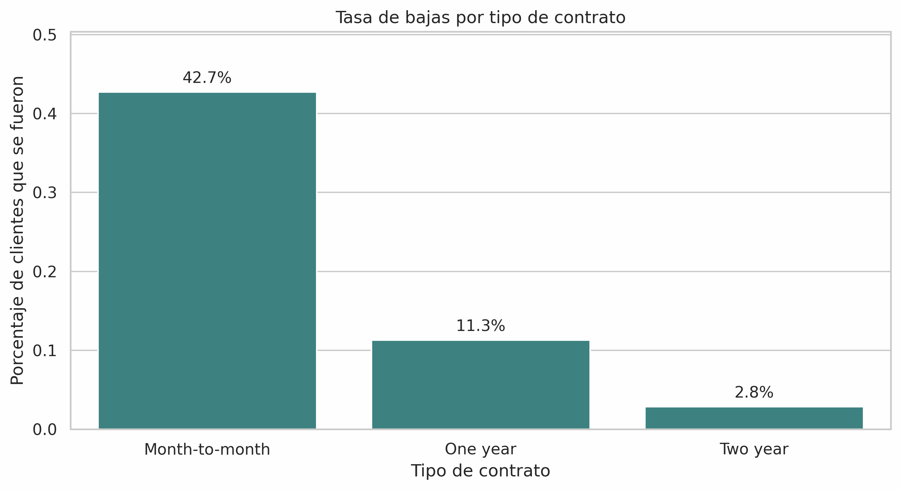
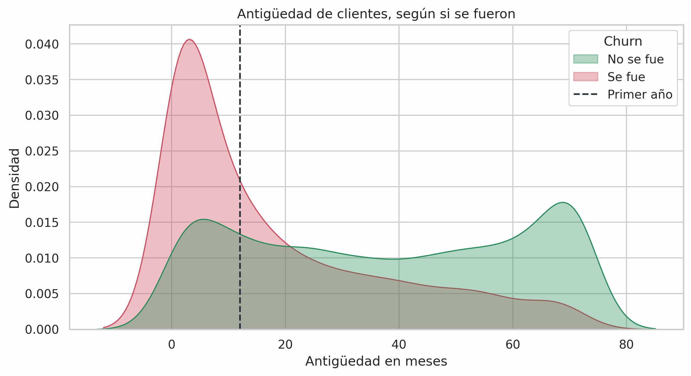
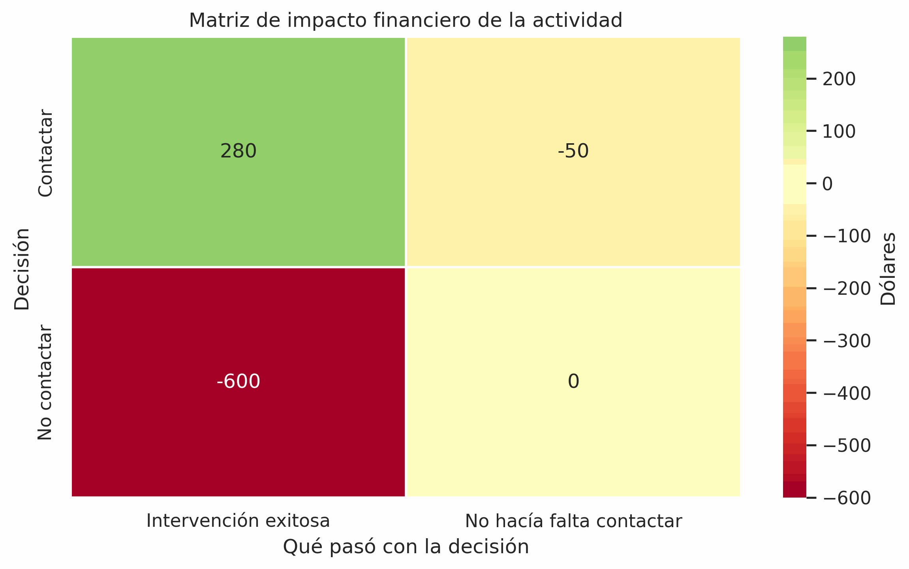

# Proyecto de retención de clientes - PP2

En este proyecto trabajé con el dataset Telco Customer Churn. Primero cargué y revisé el CSV. Después preparé una base relacional en MySQL, comparé tres modelos y usé sus probabilidades para simular una decisión de retención.

## Qué entregué

- Los scripts para crear y cargar las tablas en MySQL Workbench.
- El CSV original de la cátedra y el diagrama relacional.
- Dos notebooks para la limpieza, comparación de modelos y decisión financiera.
- Un script Python que genera los tres gráficos pedidos en la clase 5.
- El informe técnico en PDF y el pitch de siete diapositivas.

## Cómo cargar la base en MySQL Workbench

1. Descargá `data_and_sql/Telco_Customer_Churn.csv` desde este repositorio.
2. Abrí `data_and_sql/01_modelo_relacional.sql` en MySQL Workbench y ejecutá el archivo completo. Se crean la base `churn_db`, la tabla temporal `stg_telco` y las cuatro tablas finales.
3. En el panel Schemas, hacé clic derecho sobre `stg_telco` y elegí **Table Data Import Wizard**. Seleccioná el CSV. Los encabezados del archivo coinciden con las columnas de la tabla.
4. Abrí y ejecutá `data_and_sql/02_normalizar_datos.sql`. Este paso copia los datos a las tablas finales y convierte los 11 cargos totales vacíos en cero.
5. Ejecutá `data_and_sql/05_consultas.sql`. Después de cargar y normalizar, deberían aparecer 7.043 filas en cada tabla final y cero relaciones sin cliente.
6. Abrí `data_and_sql/consultas_churn.sql` y `data_and_sql/clase4_dml_transacciones.sql` para las prácticas.

Las tablas finales son `clientes`, `servicios`, `facturacion` y `registro_churn`. Cada una conserva un tema y tiene una clave foránea hacia `clientes`. En `servicios`, `facturacion` y `registro_churn` dejé un registro por cliente.

## Cómo correr los notebooks

1. Abrí `notebooks/01_churn_baseline.ipynb` en Google Colab y ejecuté las celdas en orden. El notebook descarga el mismo CSV que usa el script de la profesora.
2. Al final se guarda `predicciones_para_revision.csv`. Lo descargué desde Colab.
3. Abrí `notebooks/02_decision_financiera.ipynb`, subí ese archivo y ejecuté las celdas.

El notebook deja apagada por defecto la conexión de SQLAlchemy. Google Colab no puede llegar al `localhost` de mi computadora. Para usar esa opción, primero creé las tablas con el SQL, cambié `CARGAR_EN_MYSQL` a `True` y ejecuté el código desde la misma computadora que tiene MySQL o desde un servidor accesible. El código pide el host, usuario y contraseña; no guardé contraseñas en el repositorio. Para Workbench, seguí los pasos de importación de arriba. Usé una sola forma de carga por vez.

## Hallazgos visuales y análisis financiero

### Bajas por tipo de contrato

En el CSV, se fue el 42,7 % de los clientes con contrato mensual. La tasa fue 11,3 % en contratos de un año y 2,8 % en contratos de dos años. El contrato mensual aparece como el grupo con más bajas; el gráfico muestra una relación, no prueba por sí solo que el contrato sea la causa.

### Antigüedad

La tasa de baja fue 47,4 % entre quienes llevaban hasta 12 meses y 17,1 % entre quienes llevaban más de 12 meses. Por eso marcaría el primer año como una ventana para probar acciones de acompañamiento.

### Matriz de decisiones de la clase

La actividad asigna +280 dólares a una intervención exitosa, -50 a un contacto innecesario, -600 a perder un cliente sin intervenir y 0 a continuar normalmente. Estos valores son los de la consigna. No son resultados observados en el dataset.

## Diccionario de datos

| Tabla | Campo | Qué significa |
|---|---|---|
| `clientes` | `id_cliente` | Identificador original del cliente. Es la clave primaria. |
| `clientes` | `genero`, `adulto_mayor`, `pareja`, `dependientes` | Datos básicos del cliente. `adulto_mayor` usa 0 o 1. |
| `servicios` | `id_servicio` | Identificador creado automáticamente por MySQL. |
| `servicios` | `id_cliente`, `antiguedad_meses` | Cliente relacionado y meses que lleva con el servicio. |
| `servicios` | `servicio_telefonico`, `multiples_lineas`, `servicio_internet` | Datos de teléfono, líneas e internet. |
| `servicios` | `seguridad_online`, `respaldo_online`, `proteccion_dispositivo`, `soporte_tecnico` | Servicios adicionales de protección y soporte. |
| `servicios` | `streaming_tv`, `streaming_peliculas` | Servicios de streaming. |
| `facturacion` | `id_facturacion` | Identificador creado automáticamente por MySQL. |
| `facturacion` | `id_cliente`, `tipo_contrato`, `facturacion_digital`, `metodo_pago` | Cliente, contrato, factura digital y forma de pago. |
| `facturacion` | `cargo_mensual`, `cargo_total` | Cargo del mes y cargos acumulados del cliente. |
| `registro_churn` | `id_registro` | Identificador creado automáticamente por MySQL. |
| `registro_churn` | `id_cliente`, `churn` | Cliente y resultado: `Yes` si se fue, `No` si siguió. |

Las columnas de `stg_telco` mantienen los nombres del CSV original para que Workbench pueda importar el archivo sin renombrarlos.

## Modelos y resultados

Separé los datos en 60 % entrenamiento, 20 % validación y 20 % prueba, usando la semilla 42. Coloqué el sobremuestreo dentro del pipeline para que se aplicara solo al entrenamiento. Elegí por ROC AUC en validación porque quería comparar cómo ordenaban el riesgo sin depender de un único corte. XGBoost obtuvo el valor más alto, pero quedó muy cerca de Regresión Logística.

| Modelo | ROC AUC en validación | Recall en validación |
|---|---:|---:|
| XGBoost | 0,839 | 0,791 |
| Regresión Logística | 0,836 | 0,794 |
| Random Forest | 0,809 | 0,551 |

En prueba, XGBoost obtuvo ROC AUC 0,843, recall 0,802, precisión 0,508 y Brier 0,164 con corte 0,5. Con los supuestos económicos del notebook, el umbral que maximizó el valor esperado en validación fue 0,36. Aplicado a prueba, habría recomendado contactar a 744 de 1.409 clientes; el valor neto esperado simulado fue 11.290,50 dólares y el ROI simulado 75,88 %.

## Supuestos de la simulación

El CSV no informa cuánto cuesta una campaña, el margen por cliente ni si una intervención logra retenerlo. Para mostrar el cálculo usé valores de ejemplo: 20 dólares por campaña, seis meses de margen, margen estimado del 40 % y éxito de campaña del 30 %. Por eso el umbral, el valor neto y el ROI son una simulación, no una ganancia real prometida. La matriz de la actividad de clase es otro ejercicio, con sus valores propios.

## Archivos principales

- `data_and_sql/01_modelo_relacional.sql`: crea la base y las tablas.
- `data_and_sql/02_normalizar_datos.sql`: reparte los datos importados en las cuatro tablas finales.
- `data_and_sql/consultas_churn.sql`: consultas simples y combinadas.
- `data_and_sql/clase4_dml_transacciones.sql`: INSERT, UPDATE, DELETE, COMMIT y ROLLBACK.
- `data_and_sql/05_consultas.sql`: conteos y revisión de relaciones.
- `notebooks/01_churn_baseline.ipynb`: limpieza y comparación de modelos.
- `notebooks/02_decision_financiera.ipynb`: umbral económico.
- `notebooks/03_visualizaciones.py`: gráficos de la clase 5.
- `informe_tecnico.pdf`: informe con los apartados de la consigna.
- `pitch_7_diapositivas.pptx`: resumen para la exposición oral.

## Fuente del dataset

Usé el enlace que aparece en el script de descarga de la profesora: [Telco Customer Churn](https://raw.githubusercontent.com/IBM/telco-customer-churn-on-icp4d/master/data/Telco-Customer-Churn.csv). El archivo tiene 7.043 filas y 21 columnas.
